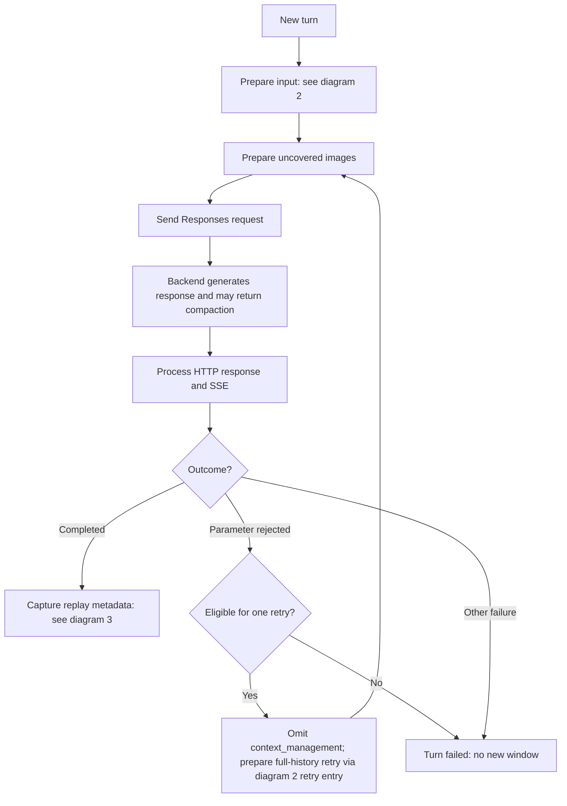
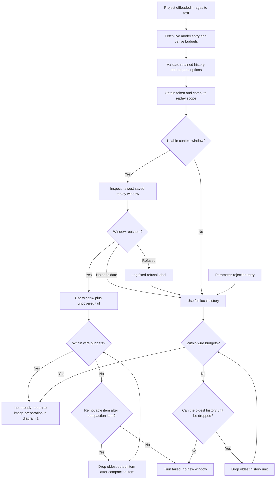
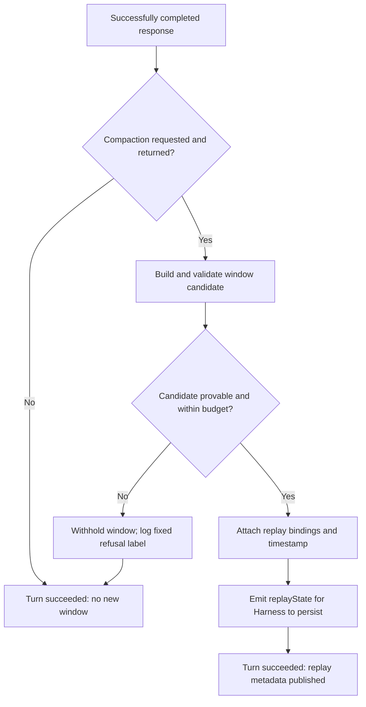

# Subscription server-side compaction

## Overview

When a conversation on this provider grows long, the subscription backend can condense older history into one encrypted item. The bridge asks for that condensation whenever the model discloses a usable context window. It saves the returned item and replays it on later turns instead of resending the older history. The summary is opaque: the bridge cannot read it, so it echoes the item as received.

Harness local summarization stays enabled by default. An optional preset replaces it for this provider alone, so Codex can own condensation without changing the stock installation. See [Optional preset](#optional-preset).

## Default behavior

- Compaction is always requested. The adapter has no configuration keys for it.
- Every request is stateless: it is sent with `store: false`, and the endpoint rejects `previous_response_id`.
- When the model discloses a usable context window, the request asks the backend to condense at 95% of that window. A per-model percent from the model catalog replaces that ratio when disclosed.
- Without a usable disclosed window, ordinary bounded requests continue. No compaction item can appear, because the backend compacts only when the bridge sends a threshold.
- Keep Harness local summarization enabled. The host and the bridge can both condense; neither blocks the other.

## What you see in chat

- A turn whose response published a compaction window shows a `Server-side compaction` marker in that turn's work-details disclosure.
- The marker names the model and the size of the saved window, for example `encrypted window, 5 items · gpt-5.1`.
- It sits in the turn's work-details disclosure, like the chat's own local-condensation marker, so it follows the transcript-view setting.
- The marker is derived on the client from the assistant message's `replayState`. It needs no session event.
- A turn that compacted nothing publishes no marker. A window the bridge cannot prove leaves the turn unmarked.
- Refusals are not durable in the session. They appear in the host log.

## Optional preset

A profile can let this package's engine own condensation by enabling the preset it ships, `preset-codex-subscription`.

- The engine extends the host's stock engine. For `codex-subscription` requests it returns without condensing; every other provider is delegated unchanged.
- The preset is not enabled by default. Installing the package must not add a selectable preset to every profile.
- Enabling it is a profile patch with an id-keyed override. [The installation guide](INSTALL.md) records the step, the post-mount checks and the failure modes.

The pinned Harness fixes where that engine has to live:

- The bundle disables the top-level `compaction-basic` and `command-compact` rows and declares the backend inside each agent preset, in an isolated `compaction` group.
- A profile patch can override an existing row by id, but cannot add one without an `insert:` list, and cannot address an entry nested in a preset's `plugins` list at all.
- A preset is a complete declaration, so the shipped patch restates the standard composition with that one child's engine replaced.
- `scripts/sync-preset.mjs` derives the copy from the pinned Harness, so a Harness bump shows up as a small reviewable diff. Profile verification runs the script's `--check` mode, because a release that reshapes the `compaction` group would otherwise let double summarization return silently.

Enabling it accepts a coupling the bridge otherwise avoids:

- The module subclasses a host-internal class. If that package disappears, the preset fails its activation audit and stops composing.
- If the reconciled method changes shape, the override silently degrades to the stock behavior instead of breaking.
- While the replacement is mounted, no local summary bounds the transcript, so the refusal and wire-budget behavior below is the only remaining recovery path.

## Limitations and recovery

- Reuse is exact. A saved window is reused only when the current transcript is exactly the input it was captured on plus the assistant answer it describes.
- Anything that changes history invalidates the window: a model or account change, message edits, local summarization, image offload changes, changed tools or instructions. The window also expires after 24 hours.
- Only the newest window is considered. Older windows are not searched as a fallback.
- A refused window is not an error. The turn falls back to the full bounded history.
- When the full history does not fit, the bridge drops the oldest items until the request fits. Trimming deletes content; a dropped item carries no summary.
- An image occurrence is never dropped. The host offloads its oldest images instead.
- When nothing is left to drop, the turn fails. Start a new conversation.
- A request that fits the bridge's byte budgets can still exceed the backend's token ceiling. That rejection is reported as `CONTEXT_LIMIT`.
- Even with local summarization enabled, the host measures tokens, not bytes, so it may not condense before the bridge's byte limits bite. Recovery independent of the retained transcript remains an open limitation.

---

The rest of this page is technical background.

## How it works

The bridge issues the compaction request unconditionally. Route compatibility cannot be checked locally, so an explicit unsupported-parameter rejection falls back once to the original bounded request. See [Trimming and fallback](#trimming-and-fallback).

### Request shape and threshold

- With a disclosed safe-integer context window of at least 2048 tokens, the request includes `context_management: [{ type: 'compaction', compact_threshold: floor(contextWindow × ratio) }]`.
- `ratio` is the catalog's `effective_context_window_percent` divided by 100. A disclosed value that is not a usable percent fails closed rather than being quietly replaced.
- The shipped fallback is `ratio = 0.95`. That is the value observed on this account, so the shipped ratio matches it today without being a measurement of every model. The live catalog discloses no percent for this account's models, so the fallback is what runs in practice.
- The backend compares its own rendered token count against the threshold sent. The byte bounds below are a resource guard, not a token guarantee.
- The backend has no default threshold of its own: a request carrying no `context_management` was measured past the disclosed window and completed without a compaction item, so compaction runs only when the bridge sends a threshold.
- No user-supplied threshold, destination, credentials, API-key access, or standalone compact endpoint is introduced.

### Turn processing flow

The diagrams describe the bridge's request and replay-metadata paths. Harness local condensation is a separate host operation; the [opt-in preset](#optional-preset) suppresses its automatic condensation for this provider, but does not change these paths or the host token meter.

The diagrams use these terms:

| Term | Meaning |
| --- | --- |
| Local history | The conversation Harness retains, including messages not sent on this turn. |
| Replay window | A saved compaction item and the following allowlisted output items. |
| Covered prefix | The older history a validated replay window replaces. |
| Uncovered tail | Messages added after that covered prefix. |
| Budgets | Separate limits for retained history, wire text/tool history, checkpoints and images; not a token count or a single serialized-body size limit. |

#### 1. Turn overview

- Every request uses `store: false`. The first attempt includes `context_management` only when the model discloses a usable context window.
- HTTP errors and SSE terminal errors are processed before the retry decision.
- A retry is eligible only on the first attempt, before anything has been delivered to the host, for a structured `unsupported_parameter` or `unknown_parameter` rejection naming `context_management`. The rejection must come from an HTTP 400/422 error body or an SSE terminal error. The retry takes diagram 2's full-history path, including its budget checks; it never reuses a window or sends the rejected parameter again.
- Cancellation, deadlines, authentication errors and invalid input can fail the turn at the relevant stage; those exits are omitted from the diagram. Image preparation enforces its own budgets; `IMAGE_OFFLOAD_REQUIRED` asks Harness to offload images and retry. That is separate from the parameter-rejection retry.

#### 2. Select input and fit the budgets

- **Window selection:** a usable context window is a disclosed safe integer of at least 2048 tokens. The newest saved window must pass scope, covered-prefix, assistant-content, age, shape and digest checks. Developer instructions remain separate, and the uncovered tail may contain new messages. A refusal falls back to full history; older windows are not searched.
- **Replay path:** only output items following the compaction item may be removed to fit the wire budgets. The compaction item, developer instructions and uncovered tail remain.
- **Full-history path:** trimming runs only when budgets are exceeded. It drops the oldest history units, keeping a tool call and its executed result together, and never drops an image occurrence. It does not skip a protected oldest item to delete newer items: an image at the oldest end blocks further trimming. The final remaining input item is never dropped.
- **Failure boundary:** exhausted trimming reports `INPUT_UNSUPPORTED`, except that the full-history path after an explicit window refusal reports `COMPACTION_UNAVAILABLE`. Retained-history validation can fail before trimming starts.

#### 3. Capture the next replay window

- While streaming the answer, the bridge observes completed output items. After successful completion, candidate validation checks their order, any terminal compaction echo, agreement with delivered assistant content, and the item allowlist.
- The candidate starts at the last compaction item. Oldest following output items may be removed to fit the checkpoint budget; the compaction item stays.
- An invalid or unprovable candidate is withheld. The answer has already been delivered, so the refusal only costs the next turn's replay.
- Harness persists the window on the assistant message. The client derives the marker from that metadata, and the next turn validates the window again before reuse.
- A reuse-only turn publishes no new window or marker. Withholding a new window does not erase older metadata, but the next turn still validates the newest available candidate and never searches older windows after a refusal.

## Replay validation and resource limits

### State and validation

- Only successfully completed responses can publish replay metadata. Cancelled, failed, malformed and incomplete responses cannot publish a window.
- A window holds the allowlisted, bounded wire items the backend returned for the turn that compacted — including opaque encrypted content — plus the digests that bind those items to the transcript. Nothing outside the item allowlist is persisted, and the window is bounded by the same derived value the request bound uses.
- A turn reuses a window only when the current transcript is exactly the input the window was captured on plus the assistant answer that window describes. A divergence is refused rather than trusted, and the turn sends the full bounded history.
- The streamed completed items remain the authoritative output order for the marker. The live backend omits items from `response.completed.response.output` — observed as a missing index once a real compaction was issued — so positional agreement with that array is not required. A terminal compaction item that exists and disagrees with the streamed one is still treated as a contradiction.
- An unprovable window or marker is never published and never fails the turn. The answer has already been delivered, so the first refusal label is logged. Refusals name their own stage from a bridge-owned vocabulary (`SHAPE`, `METADATA`, `EXPIRED`, `SCOPE`, `PREFIX`, `CONTENT`, `DIGEST`, `INVALID`, and the marker stages `ITEM_*`, `MSG_*`, `SUM_*`, `WINDOW_SHAPE`, `WINDOW_BYTES`, `NO_ORDER`, `OBSERVE_DUPLICATE`, `COMPACTION_MISMATCH`, `CONTENT_MISMATCH`), so no response value reaches the log.
- Harness stores the window in the assistant message's `source.replayState.response.subscriptionCompactionV1`. The normal transcript stays intact. No separate bridge state file or process-global cache exists.
- The window binds to a hash of dedicated account routing headers and available subject/user claims, model, developer instructions and tool definitions, plus the exact input and assistant-content digests. The newest window must match; older windows are not searched as a fallback. Refresh with unchanged account routing does not itself invalidate it. Account/model changes, edits, local summarization, image offload changes and changed tools or instructions invalidate it.
- Windows expire after 24 hours. That is a conservative local policy, not a claimed backend expiration guarantee. Future timestamps and malformed or digest-mismatched metadata are rejected. Hashes detect inconsistency, not malicious forgery by trusted same-user code.

### Bounds

The budgets are byte and item counts, not token counts. The derived value is the threshold expressed in bytes at a conservative 8 bytes per token. Every turn sends the input the bridge can prove, so every turn's input is bounded. The model catalog lookup runs before validation, because the bounds depend on the disclosed window.

| Budget | Retained history (first pass) | Wire request |
| --- | --- | --- |
| Items | 4096 | 1024 |
| Text bytes | max(derived, 4 MiB) | max(derived, 256 KiB) |
| Tool call/result bytes | max(derived, 16 MiB) | max(derived, 2 MiB) |
| Text and tool combined | max(derived, 20 MiB) | max(derived, 2.25 MiB) |

When no usable window is disclosed, the derived value equals the combined floor, so text and tool are each bounded by the combined floor too.

| Budget | Value |
| --- | --- |
| Replay window items | at most 128 |
| Per item, and the window total | at most max(derived, 512 KiB) |
| SSE frame, with compaction requested | at most 2 × window bound |
| SSE aggregate, with compaction requested | at most 3 × frame + 4 MiB |
| SSE event count, with compaction requested | at most 65536, derived from the frame bound |
| SSE frame / aggregate without a threshold | 1 MiB / 4 MiB (fixed) |
| SSE event count without a threshold | 4096 (fixed) |
| Marker output indices | at most 128 |

- The wire bound is a resource limit for one request, not a guard against rejection. The backend compacts a request whose measured count is past the model window, so a request past the window in the bridge's byte estimate is sent as it is.
- A reused window replaces only its exact covered prefix; the uncovered tail is the live conversation. The compaction item itself is what makes the window replayable.
- Covered images are not read or resent; uncovered images use the existing attachment and offload budgets.
- One compaction item travels inside one event frame and repeats in up to three events (`response.output_item.added`, `.done` and the `response.completed` echo). The raised frame and aggregate bounds admit those occurrences. An item past the capture bound but inside the raised frame limit is refused gently: the checkpoint is withheld, the refusal is logged and the next turn resends the full history. A frame past the raised limit still fails the turn.
- The event count rises with the same admitted window. A long answer streams many small deltas — including reasoning deltas the bridge does not forward — and the default 4096-event count fails such a turn before any text is delivered. The count sizes from the frame bound at a conservative 128-byte event envelope estimate — smaller events, such as a 10-byte `data: {}\n\n` keepalive-shaped frame, are bounded by the aggregate byte limit instead — capped at 65536. Without a threshold the default 4096-event count stands unchanged.
- Without a threshold no compaction item can appear, and the fixed frame, aggregate, timeout, admission and cancellation bounds stand unchanged.

### Trimming and fallback

- Trimming deletes what it drops and creates no summary. It enforces the resource bounds, not the backend's token ceiling. The number of dropped items is named in the host log.
- When nothing is left to drop, the turn fails with `INPUT_UNSUPPORTED`, and the limits are never raised silently. Only the full-history path after an explicit window refusal reports that failure as `COMPACTION_UNAVAILABLE`.
- There is no retry after partial output, arbitrary 400 errors, quota or authentication failures, network ambiguity or stream failure. An unrecognized rejection is a safe fixed failure, not an automatic retry with potentially oversized history.
- Measured on this backend, the structured rejection arrives in the SSE error event (`code`, `param`, `type`); the HTTP error body carries `{ detail }`. Both shapes are read, because the HTTP-body path did not fire in the measured run.
- A structured `context_length_exceeded` terminal error is reported as `CONTEXT_LIMIT` rather than the generic upstream failure. The request byte bound can admit a request past the backend's enforced ceiling, because bytes are an estimate of tokens.

## Design background

### Why the request is stateless

The subscription backend requires `store: false` and rejects `previous_response_id` — measured on a real account — so there is no server-side conversation to reference. Every turn sends the input the bridge can prove, with the compaction window echoed back in the input array. A stateful form would keep the prefix unchanged across compaction. That is the only capability this backend cannot provide, and what that costs is recorded under [differences deliberately not closed](#differences-deliberately-not-closed).

### Differences deliberately not closed

These are recorded as differences, not as gaps to close.

- The official client uses the standalone `/responses/compact` endpoint and a window chain (`window_number`, `first_window_id`, `previous_window_id`, `window_id`). The bridge uses inline `context_management`, which the live backend has accepted, and adds no second destination. `body_after_prefix` is a concept of that endpoint and cannot be expressed inline, so the measured object is not the same even when the threshold matches. The binary carries no `context_management` string at all, so the inline shape is the bridge's choice and not the client's.
- The client's compaction trigger reasons appear in the binary as the names `user_requested`, `context_limit`, `model_downshift` and `comp_hash_changed`; the condition attached to each is not readable. The bridge has a threshold only: it holds no compaction configuration to hash, and a model change changes its threshold rather than triggering a compaction pass of its own.
- Statefulness is a gap that cannot be closed on this backend. The client's `store: true` + `previous_response_id` shape is rejected by the subscription endpoint on this account, so the prefix cannot survive compaction and the cache hit on a firing turn stays at 0%. The cache re-engages on the turns after a firing, measured at 74.8% on one turn, but hits are intermittent and not guaranteed.
- The window the bridge carries is a lossy summary. Measured on a real account, the model's view on the firing turn is the full content; exact non-derivable tokens placed in the oldest region were answered on that turn and not answered on the next turn when the opaque window item was replayed alone. The bridge cannot read the summary, so it echoes the item as received.
- The client persists threads in its own store (rollout files, sqlite). The bridge persists only the bounded compaction window in Harness replay metadata, because the host already owns the transcript.
- The client runs `PreCompact` and `PostCompact` hooks and injects reminder and guidance text into the conversation, including that long threads and repeated compactions reduce accuracy. The bridge has no hooks and injects nothing: an injected item would not be part of the host transcript the record is proved against. The accuracy difference is a real behavioral difference, not a shape difference.
- The client addresses history by position (`beforeTurnId`, `excludeTurns`, `HistoryPosition`) and can fork a thread. That is outside [the scope](SCOPE.md).
- The client's `auto_compact_fallback_buffer_tokens` exists because it measures its own estimate. The bridge leaves the count to the backend, so there is no position to put a buffer in.

### Decision and research

The baseline `ea7abda40362be71080d36b527283304159b2958` did not send `context_management`, rejected compaction output items, and did not emit replay metadata. Its existing compaction evidence was for Harness text summarization.

[OpenAI's compaction guide](https://developers.openai.com/api/docs/guides/compaction) describes inline `context_management`, encrypted output items, and stateless input-array chaining with `store: false`. That public API documentation is not a guarantee of subscription endpoint availability. The [reference plugin v2.5.9](https://github.com/WSL043/dsh-codex-subscription/blob/v2.5.9/src/subscription-compaction.js) uses this mechanism on `/backend-api/codex/responses`. A real subscription session has since confirmed both halves: the backend issued an encrypted compaction item once the request passed the then-shipped 32,768-token threshold, and the next request that echoed it back was priced at 11,787 input tokens instead of the 38,612 the same transcript had just cost. See [the verification record](VERIFICATION.md).

[Reference issue #152](https://github.com/WSL043/dsh-codex-subscription/issues/152) was closed without eliminating duplicate summaries. Its maintainer reported that suppressing local pressure compaction let the retained transcript grow beyond the model window, making model-switch recovery fail. Those experiments are the maintainer's evidence, not measurements from this implementation.

Harness 0.2.0-rc.2 has the necessary [replay envelope](https://github.com/deepseek-ai/deepseek-harness/blob/dsh-v0.2.0-rc.2/packages/llm/llm/src/assembler.ts), but its [token meter](https://github.com/deepseek-ai/deepseek-harness/blob/dsh-v0.2.0-rc.2/packages/llm/token-meter/src/index.ts) can prefer the full history estimate over a smaller provider usage report. Cloud checkpoints and local summaries can therefore both run by default: the meter prices the retained local surface, so the host still reaches its own threshold even when the wire request is compacted. This implementation does not patch the meter, change another provider, or inflate the model's disclosed window. Eliminating duplicate summarization in the default composition would need host recovery work, such as bounded chunked summarization.

## Verification

- Synthetic tests cover public Harness runtime dispatch, its actual block assembler, JSON persistence/replay, window reuse replacing only its covered prefix, post-compaction tool results, history/account/model/instruction/tool/expiry/content/digest invalidation, terminal contradictions, missing tail items, cancellation, covered images, wire budgets, oldest-end trimming with tool-call pairs kept as one unit and an image occurrence never dropped, the per-model percent and its fallback, the stateless request shape, and the narrowly scoped parameter-rejection retry.
- `test/compaction-backend.test.mjs` pins the host engine class and checks that the opt-in backend skips only this provider, delegates every other provider, survives a missing provider or session, and names each refusal label. The packaged modules are included in the normal tarball composition checks.
- Automated tests make no real authentication or subscription calls. [The verification record](VERIFICATION.md#real-account-evidence-and-limits) is the single list of what is confirmed and what is still open.
- A manually driven Desktop session confirmed real checkpoint issuance and reuse on a dedicated login. The enabled preset has since been exercised on a real account with an artificially low trigger: a subscription backend past its threshold raised no local compaction, the same preset on another provider ran the stock engine, and `/compact` still condensed. Automatic pressure at the shipped bridge ratio (258,400 tokens for the 272,000-token Codex window) is now observed on a real account; [the verification record](VERIFICATION.md#window-ratio-pressure-on-a-real-account-2026-10-18) is the measurement. The interval between firings is about 231,000 tokens of new content, and the firing point is the threshold itself.
- The bridge does not read `max_context_window`: it cannot express a token ceiling in bytes, and the disclosed value does not match the enforced ceiling, so reading it would change no decision.
- Still unverified: whether the `store: true` and `previous_response_id` rejections are endpoint-wide or this account's storage policy, and what the official client uses when `auto_compact_token_limit` is null. The configuration reference says "unset uses model defaults", the config schema carries no default, and the catalog returns null for every model on this account, so the null branch is not readable from the binary.
- After separate authorization, use an isolated profile and dedicated login for a bounded service experiment: verify issuance then reuse, cancellation and a local summary, with a fixed request/token budget and a stop condition. Record only sanitized counters and size measurements, never opaque checkpoints, credentials, account identifiers or raw authenticated responses. Because the compaction request is now always issued, that evidence should also decide whether reliance on the always-on default is justified, rather than synthetic success alone.
