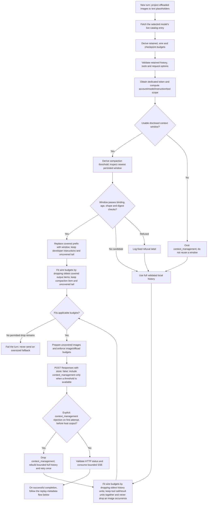
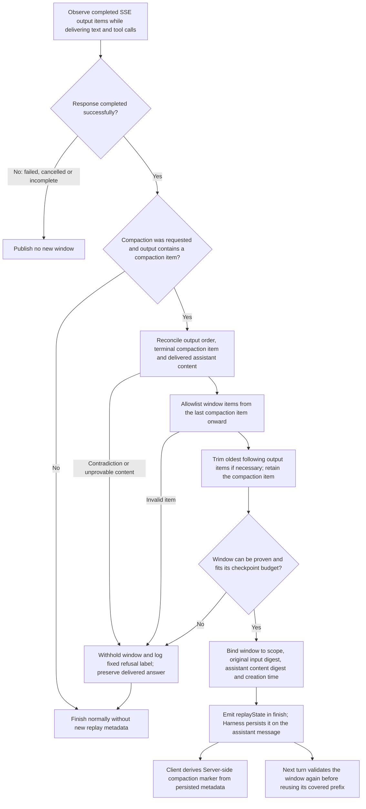

# Subscription server-side compaction

## Decision and research

The bridge implements inline server-side compaction on its existing fixed subscription Responses endpoint, and replays the bounded compaction window it captured for a turn it can prove. Harness local summarization stays in place by default; an opt-in agent preset replaces it for this provider alone, so Codex can own condensation without changing the stock installation.

The baseline `ea7abda40362be71080d36b527283304159b2958` did not send `context_management`, rejected compaction output items, and did not emit replay metadata. Its existing compaction evidence was for Harness text summarization.

[OpenAI's compaction guide](https://developers.openai.com/api/docs/guides/compaction) describes inline `context_management`, encrypted output items, and stateless input-array chaining with `store: false`. That public API documentation is not a guarantee of subscription endpoint availability. The [reference plugin v2.5.9](https://github.com/WSL043/dsh-codex-subscription/blob/v2.5.9/src/subscription-compaction.js) uses this mechanism on `/backend-api/codex/responses`. A real subscription session has since confirmed both halves: the backend issued an encrypted compaction item once the request passed the then-shipped 32,768-token threshold, and the next request that echoed it back was priced at 11,787 input tokens instead of the 38,612 the same transcript had just cost. See [the verification record](VERIFICATION.md).

The bridge follows the stateless form. The subscription backend requires `store: false` and rejects `previous_response_id` — measured on a real account — so there is no server-side conversation to reference, and every turn sends the input the bridge can prove with the compaction window echoed back in the input array. A stateful form would keep the prefix unchanged across compaction, which is the only capability this backend cannot provide; what that costs is recorded under [state and validation](#state-and-validation) below.

[Reference issue #152](https://github.com/WSL043/dsh-codex-subscription/issues/152) was closed without eliminating duplicate summaries. Its maintainer reported that suppressing local pressure compaction let the retained transcript grow beyond the model window, making model-switch recovery fail. Those experiments are the maintainer's evidence, not measurements from this implementation.

Harness 0.2.0-rc.2 has the necessary [replay envelope](https://github.com/deepseek-ai/deepseek-harness/blob/dsh-v0.2.0-rc.2/packages/llm/llm/src/assembler.ts), but its [token meter](https://github.com/deepseek-ai/deepseek-harness/blob/dsh-v0.2.0-rc.2/packages/llm/token-meter/src/index.ts) can prefer the full history estimate over a smaller provider usage report. Therefore cloud checkpoints and local summaries can both run by default: the meter prices the retained local surface, so the host still reaches its own threshold even when the wire request is compacted. This implementation does not patch the meter, change another provider, or inflate the model's disclosed window. The opt-in backend below replaces the host's automatic condensation for this provider only; eliminating duplicate summarization in the default composition would need host recovery work, such as bounded chunked summarization.

## Enablement and request shape

Server-side compaction is always requested; the adapter has no configuration keys. Route compatibility cannot be checked locally, so the request is issued unconditionally and an explicit unsupported-parameter rejection falls back once to the original bounded request (see below).

With a disclosed context window of at least 2048 tokens, the request includes `context_management: [{ type: 'compaction', compact_threshold: floor(contextWindow × effectivePercent) }]`. `effectivePercent` is the per-model value the catalog discloses as `effective_context_window_percent`; the shipped 95% is the fallback for a model that discloses no usable percent, and a disclosed value that is not a usable percent fails closed rather than being quietly replaced. 95% is the value observed on this account, so the shipped ratio matches it today without being a measurement of every model. The backend compares its own rendered token count against the number sent here, and the byte bound below is a guard, not a token guarantee. The backend has no default threshold of its own: a request carrying no `context_management` was measured past the disclosed window and completed without a compaction item, so compaction runs only when the bridge sends a threshold. Without a usable disclosed window, ordinary bounded requests continue without cloud compaction. No user-supplied threshold, destination, credentials, API-key access, or standalone compact endpoint is introduced, and the request is sent with `store: false`. The live catalog does not disclose a percent for this account's models, so the shipped fallback is what runs in practice.

## Turn processing flow

The diagrams describe the bridge's request and replay-metadata paths. Harness local condensation is a separate host operation; the [opt-in preset](#replacing-local-condensation-opt-in) suppresses its automatic condensation for this provider, but does not change these paths or the host token meter.

### Build and send the request

The retry requires `unsupported_parameter` or `unknown_parameter` naming `context_management`, read from a structured HTTP 400/422 error body or an SSE terminal error. Other failures do not authorize it. Cancellation, deadlines, authentication errors, invalid input, image preparation failures and fatal HTTP/SSE errors terminate their path; these cross-cutting exits are omitted from the diagram. An image-budget failure can request host-owned offloading through `IMAGE_OFFLOAD_REQUIRED` rather than silently dropping an image.

The wire-budget checks count text/tool history separately from the checkpoint and image budgets; they are not a token count or a single serialized-body size check. Exhausted trimming reports `INPUT_UNSUPPORTED`, except that the full-history path after an explicit checkpoint refusal maps that error to `COMPACTION_UNAVAILABLE`.

### Capture the next window

A reuse-only turn publishes no new window or marker. Withholding a new window does not erase older metadata, but the next turn must still validate the newest available candidate; it never trusts a refused candidate or searches older windows as a fallback. Trimming removes content without creating a summary, whereas backend compaction returns opaque summarized state.

## Replacing local condensation (opt-in)

A profile can let this package's engine own condensation by enabling the agent preset it ships, `preset-codex-subscription`. The engine extends the host's stock engine and returns without condensing whenever the durable request belongs to `codex-subscription`; every other provider is delegated to the stock implementation unchanged, so the composition is scoped to this provider in behavior even though the preset is selected per session. [The installation guide](INSTALL.md) records the enable step, the post-mount checks and the failure modes.

The pinned Harness fixes where that engine has to live. Its `@deepseek-ai/dsh-web-app` bundle disables the top-level `compaction-basic` and `command-compact` rows and declares the backend inside each agent preset instead, in an isolated `compaction` group; a profile patch can override an existing row by id but cannot add one without an `insert:` list, and it cannot address an entry nested in a preset's `plugins` list at all. A preset is a complete declaration, so `presets/codex-subscription.patch.yml` restates the shipped standard composition with that one child's engine replaced. [The verification record](VERIFICATION.md) has the composition evidence and the `insert:` detail.

That row is inserted **disabled**: installing the package must not add a selectable preset to every profile, and a profile enables it with an id-keyed override in the profile patch. The Plugins page lists the row but locks its switch, because the Host unlocks only rows it can address through that patch. `scripts/sync-preset.mjs` derives the copy from the pinned Harness, so a Harness bump shows up as a small reviewable diff instead of an edit to a hand-maintained file; the profile verification path runs its `--check` mode, because a release that reshapes the `compaction` group would otherwise let double summarization return silently.

This is deliberately not enabled by default. The module subclasses a host-internal class, which is a compatibility dependency the bridge otherwise avoids: if that package disappears the preset fails its activation audit and stops composing, and if the reconciled method changes shape the override silently degrades to the stock behavior instead of breaking. Operators who enable it accept that coupling; the default installation keeps the stock backend and the duplicate summarization described above.

While the replacement is mounted, no local summary bounds the transcript, so the refusal and wire-budget behavior below is the only remaining recovery path.

### What the chat shows

The issuing turn carries a `Server-side compaction` marker naming the model and the number of output items the backend compacted. It sits in the turn's work-details disclosure, like the chat's own local-condensation marker, so it follows the transcript-view setting rather than showing while every other detail is folded. It is derived entirely on the client from the assistant message's `replayState`, so it needs no session event: a turn that compacted nothing publishes no marker, and an unprovable marker leaves the turn unmarked. Refusals themselves stay in the host log, since a refusal is not durable in the session.

## State and validation

- Only successfully completed responses can publish replay metadata. Cancelled, failed, malformed and incomplete responses cannot publish a window.
- A window holds the allowlisted, bounded wire items the backend returned for the turn that compacted — including opaque encrypted content — plus the digests that bind those items to the transcript. Nothing outside the item allowlist is persisted, and the window is bounded by the same derived value the request bound uses.
- A turn reuses a window only when the current transcript is exactly the input the window was captured on plus the assistant answer that window describes. A divergence is refused rather than trusted and the turn sends the full bounded history.
- The streamed completed items remain the authoritative output order for the marker. The live backend omits items from `response.completed.response.output` — observed as a missing index once a real compaction was issued — so positional agreement with that array is not required. A terminal compaction item that exists and disagrees with the streamed one is still treated as a contradiction.
- An unprovable window or marker is never published, and never fails the turn: the answer has already been delivered by then, so the first refusal label is logged. Refusals name their own stage (`SHAPE`, `METADATA`, `EXPIRED`, `SCOPE`, `PREFIX`, `CONTENT`, `DIGEST`, `INVALID`, and the marker stages `ITEM_*`, `MSG_*`, `SUM_*`, `WINDOW_SHAPE`, `WINDOW_BYTES`, `NO_ORDER`, `OBSERVE_DUPLICATE`, `COMPACTION_MISMATCH`, `CONTENT_MISMATCH`) from a bridge-owned vocabulary, so no response value reaches the log.
- Harness stores the window in the assistant message's `source.replayState.response.subscriptionCompactionV1`. The normal transcript stays intact. No separate bridge state file or process-global cache exists.
- The window binds to a hash of dedicated account routing headers and available subject/user claims, model, developer instructions and tool definitions, plus the exact input and assistant-content digests. The newest window must match; older windows are not searched as a fallback. Refresh with unchanged account routing does not itself invalidate it. Account/model changes, edits, local summarization, image offload changes and changed tools/instructions invalidate it.
- Windows expire after 24 hours, a conservative local policy, not a claimed backend expiration guarantee. Future timestamps and malformed or digest-mismatched metadata are rejected. Hashes detect inconsistency, not malicious forgery by trusted same-user code.

## Bounds and fallback

The retained-history first pass allows at most 4096 messages, 4 MiB of text and 16 MiB of tool call/result text, so the local transcript stays bounded while a window is replayed inside the wire request. The wire request is bounded by the same window and the same percent the threshold comes from — the threshold expressed in bytes at a conservative 8 bytes per token, with the original 256 KiB text, 2 MiB tool-history and 1024-item bounds as the floor when no window is disclosed — so a request can reach the threshold instead of being refused before the backend has a chance to compact. The bound is a resource limit for one request, not a guard against rejection: the backend compacts a request whose measured count is past the model window, so a request past the window in the bridge's byte estimate is sent as it is. The model catalog lookup runs before validation because the bound depends on the disclosed window. Text and tool-history parts are each bounded by the derived value and the combined input is bounded by it too; the derived value is a guard, not a token guarantee. A full history that cannot fit under the derived bound is trimmed from the oldest end, as [the fallback](#bounds-and-fallback) below describes.

Every turn's input is bounded by the bridge, because the backend holds no conversation. A reused window replaces only its exact covered prefix; the uncovered tail is the live conversation, and the compaction item itself is what makes the window replayable. Covered images are not read or resent; uncovered images use the existing attachment and offload budgets. Output items are capped at 128 for the marker. The SSE frame and aggregate stream bounds rise with the admitted window when compaction is requested: one event frame may carry twice the checkpoint bound, because a single compaction item travels inside one frame and repeats in up to three events (`response.output_item.added`, `.done` and the `response.completed` echo), and the aggregate stream bound admits those three occurrences plus the fixed frame defaults as margin. An item past the capture bound but inside the raised frame limit is refused gently — the checkpoint is withheld, the refusal is logged and the next turn resends the full history — instead of killing the stream mid-answer; a frame past the raised limit still fails the turn. Without a derived threshold no compaction item can appear, and the fixed frame, aggregate, timeout, admission and cancellation bounds stand unchanged.

When no window is reusable, the full local transcript is the remaining input. Following the official client, the bridge drops the oldest history items until the request fits instead of failing the turn; a tool call and its executed result are dropped as one unit so no result is left orphaned, and an image occurrence is never dropped because the host owns the attachment store and offloads its oldest images instead. The number of dropped items is named in the host log. This trimming enforces the resource bound; it is not what keeps the request inside the model window, because the backend compacts a request past the window. Trimming deletes what it drops, so a dropped item carries no summary — that is the difference from compaction, and it is why trimming runs only when the request exceeds the resource bound. When nothing is left to drop, the turn fails with `COMPACTION_UNAVAILABLE` rather than reporting the generic shape error, and limits are never raised silently. An HTTP 400/422 with a bounded structured error naming `context_management` with `unsupported_parameter` or `unknown_parameter` permits exactly one retry with ordinary, fully validated history and without the rejected parameter, and the same structured rejection read from an SSE error event permits it when nothing has been delivered to the host yet. There is no retry after partial output, arbitrary 400 errors, quota/authentication failures, network ambiguity or stream failure. An unrecognized rejection is a safe fixed failure, not an automatic retry with potentially oversized history. Measured on this backend, the structured rejection arrives in the SSE error event (`code`, `param`, `type`), not in the HTTP error body, which carries `{ detail }`; the HTTP-body path did not fire in that run, so both shapes are read. A structured `context_length_exceeded` terminal error is reported as `CONTEXT_LIMIT` rather than the generic upstream failure, because the request byte bound can admit a request past the backend's enforced ceiling for content that tokenizes denser than the assumed ratio. Only fixed codes and the fixed parameter name are read; upstream message text is never kept.

Keep Harness local summarization enabled. Even that does not guarantee it runs before this bridge's byte limits, because the host measures tokens, not UTF-8 bytes. Long-lived recovery independent of the retained transcript remains an explicitly unresolved limitation.

## Differences deliberately not closed

These are recorded as differences, not as gaps to close.

- The official client uses the standalone `/responses/compact` endpoint and a window chain (`window_number`, `first_window_id`, `previous_window_id`, `window_id`). The bridge uses inline `context_management`, which the live backend has accepted, and adds no second destination. `body_after_prefix` is a concept of that endpoint and cannot be expressed inline, so the measured object is not the same even when the threshold matches. The binary carries no `context_management` string at all, so the inline shape is the bridge's choice and not the client's.
- The client's compaction trigger reasons appear in the binary as the names `user_requested`, `context_limit`, `model_downshift` and `comp_hash_changed`; the condition attached to each is not readable. The bridge has a threshold only: it holds no compaction configuration to hash, and a model change changes its threshold rather than triggering a compaction pass of its own.
- Statefulness is a gap that cannot be closed on this backend. The client's `store: true` + `previous_response_id` shape is rejected by the subscription endpoint on this account, so the prefix cannot survive compaction and the cache hit on a firing turn stays at 0%. The cache re-engages on the turns after a firing, measured at 74.8% on one turn, but hits are intermittent and not guaranteed.
- The window the bridge carries is a lossy summary. Measured on a real account, the model's view on the firing turn is the full content; exact non-derivable tokens placed in the oldest region were answered on that turn and not answered on the next turn when the opaque window item was replayed alone. The bridge cannot read the summary, so it echoes the item as received.
- The client persists threads in its own store (rollout files, sqlite). The bridge persists only the bounded compaction window in Harness replay metadata, because the host already owns the transcript.
- The client runs `PreCompact` and `PostCompact` hooks and injects reminder and guidance text into the conversation, including that long threads and repeated compactions reduce accuracy. The bridge has no hooks and injects nothing: an injected item would not be part of the host transcript the record is proved against. The accuracy difference is a real behavioral difference, not a shape difference.
- The client addresses history by position (`beforeTurnId`, `excludeTurns`, `HistoryPosition`) and can fork a thread. That is outside [the scope](SCOPE.md).
- The client's `auto_compact_fallback_buffer_tokens` exists because it measures its own estimate. The bridge leaves the count to the backend, so there is no position to put a buffer in.

## Verification and remaining work

Synthetic tests cover public Harness runtime dispatch, its actual block assembler, JSON persistence/replay, window reuse replacing only its covered prefix, post-compaction tool results, history/account/model/instruction/tool/expiry/content/digest invalidation, terminal contradictions, missing tail items, cancellation, covered images, wire budgets, oldest-end trimming with tool-call pairs kept as one unit and an image occurrence never dropped, the per-model percent and its fallback, the stateless request shape, and the narrowly scoped parameter-rejection retry. `test/compaction-backend.test.mjs` pins the host engine class and checks that the opt-in backend skips only this provider, delegates every other provider, survives a missing provider or session, and names each refusal label. The packaged modules are included in the normal tarball composition checks.

Automated tests make no real authentication or subscription calls. A manually driven Desktop session confirmed real checkpoint issuance and reuse on a dedicated login; [the verification record](VERIFICATION.md#real-account-evidence-and-limits) is the single list of what is confirmed and what is still open. The opt-in backend is checked at the module boundary against the pinned `@deepseek-ai/dsh-compaction-basic`, and its preset row is checked for shape, composition and drift. The enabled preset has since been exercised on a real account with an artificially low trigger: a subscription backend past its threshold raised no local compaction, the same preset on another provider ran the stock engine, and `/compact` still condensed. Automatic pressure at the shipped bridge ratio (258,400 tokens for the 272,000-token Codex window) is now observed on a real account; [the verification record](VERIFICATION.md#window-ratio-pressure-on-a-real-account-2026-10-18) is the measurement.

Measured on a real account, the subscription backend rejects `store: true` and rejects `previous_response_id`, so the stateful path is not available on this backend and the stateless form is the only shape it accepts. The live catalog discloses no `effective_context_window_percent` for this account's models, so the shipped fallback is what runs. Measured on a real account, the backend has no default compaction threshold of its own: a request carrying no `context_management` completed past the disclosed window without a compaction item, so the threshold the bridge sends is what makes compaction happen. Still unverified: whether that rejection is endpoint-wide or this account's storage policy, and what the official client uses when `auto_compact_token_limit` is null — the configuration reference says "unset uses model defaults", the config schema carries no default, and the catalog returns null for every model on this account, so the null branch is not readable from the binary. Measured on a real account, the interval between firings is about 231,000 tokens of new content and the firing point is the threshold itself. The bridge does not read `max_context_window`: it cannot express a token ceiling in bytes, and the disclosed value does not match the enforced ceiling, so reading it would change no decision. [The verification record](VERIFICATION.md) is the single list of what is confirmed and what is still open.

After separate authorization, use an isolated profile and dedicated login for a bounded service experiment: verify issuance then reuse, cancellation and a local summary, with a fixed request/token budget and a stop condition. Record only sanitized counters and size measurements, never opaque checkpoints, credentials, account identifiers or raw authenticated responses. Because the compaction request is now always issued, that evidence should also decide whether reliance on the always-on default is justified, rather than synthetic success alone.
